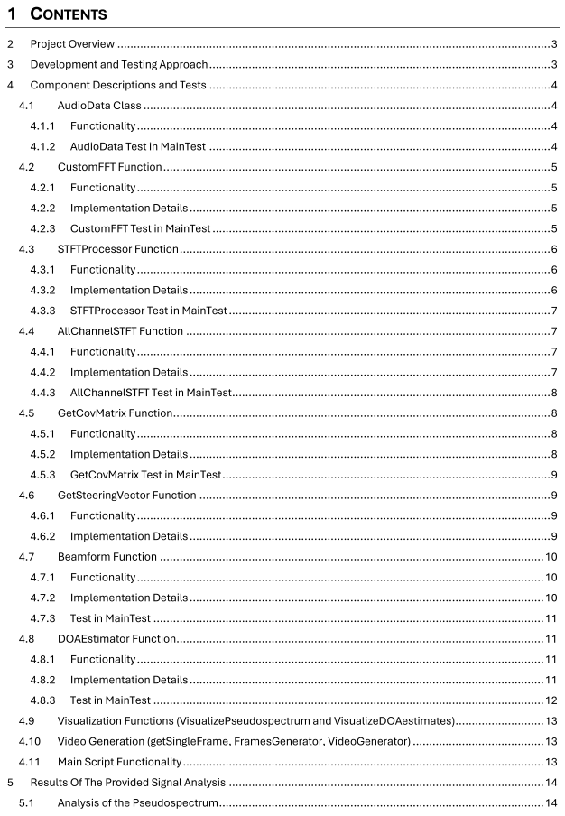
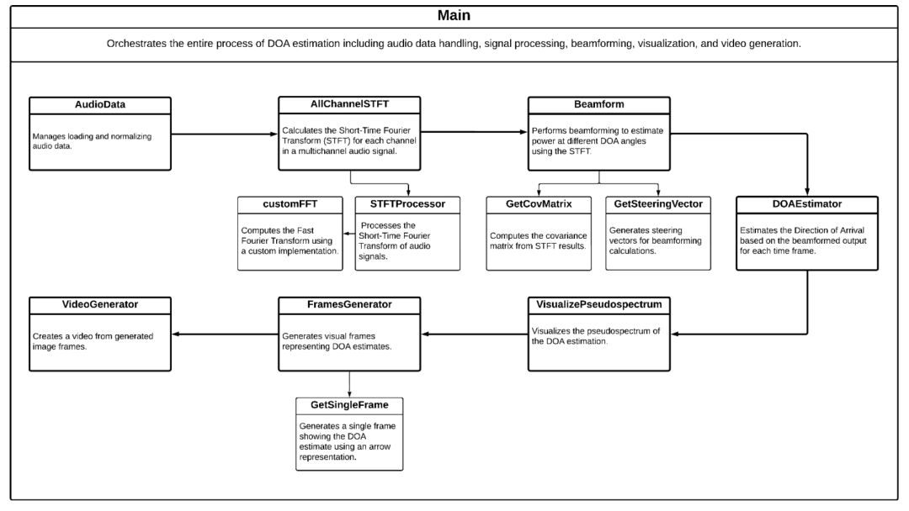
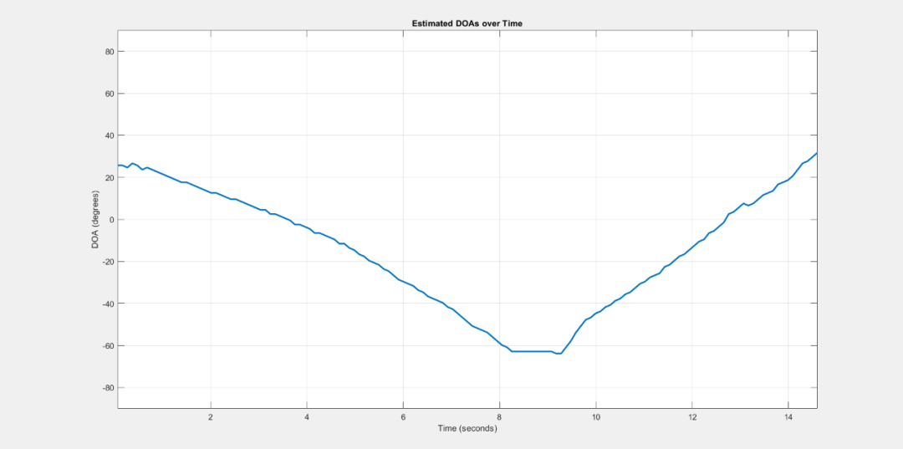
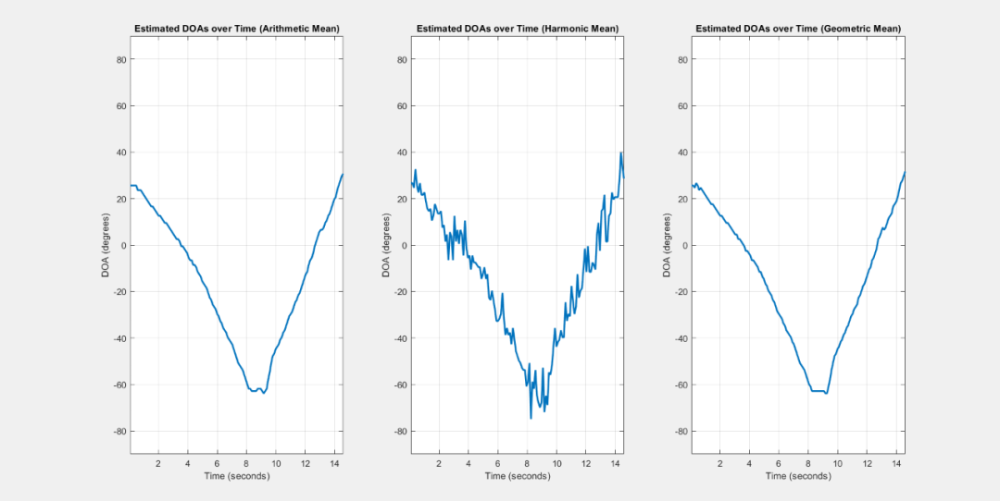
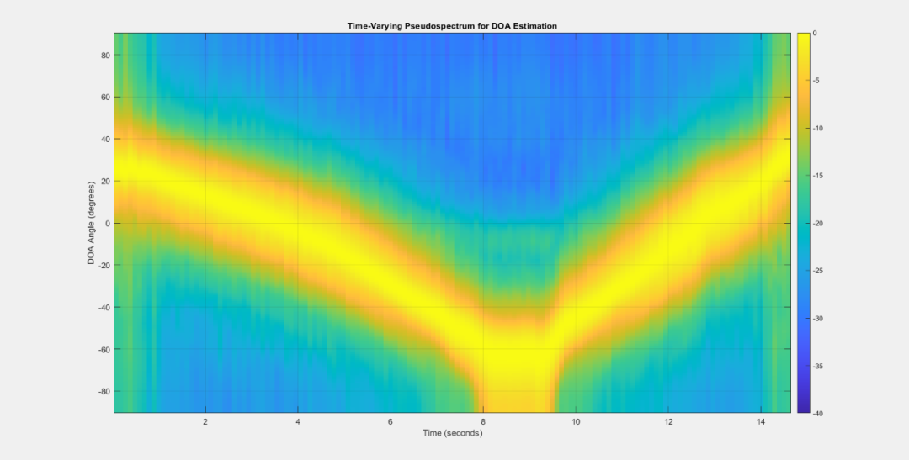
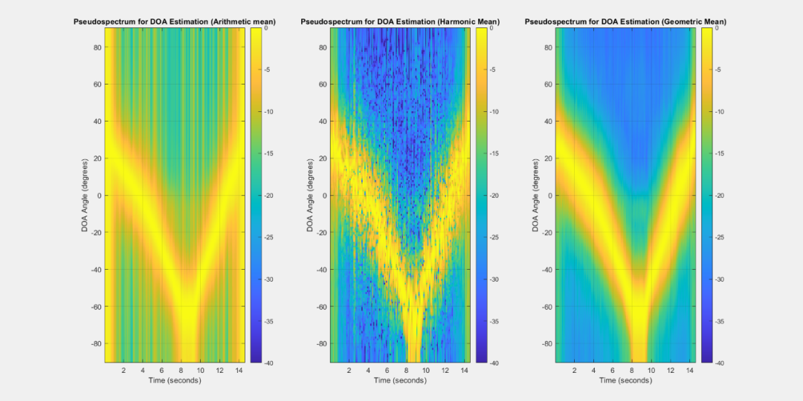

# [Direction Finding]Sound Source Positioning MATLAB Code and Report

Our goal is to achieve a delay and sum beamformer for broadband sources. Given the narrow band characteristics of spatial filtering, this project independently processes each frequency band and performs spatial filtering frame by frame to adapt to the time-varying nature of the source.
The development strategy for testing follows an iterative bottom-up approach, starting with basic components and progressively integrating and testing higher-level functionalities. Each component is verified through dedicated test cases (contained in the MainTest.m script), which are individually tested before proceeding to system-level integration.
The use flow of classes/functions is shown in the following diagram.
MATLAB Simulation Results

## Images

<!-- PAYMENT_BLOCK -->

## Get this dataset

- Payment link (Stripe): [Buy now](https://buy.stripe.com/3cs8yP7sY87d0vu9AB)
- Payment QR code: 

<!-- /PAYMENT_BLOCK -->
